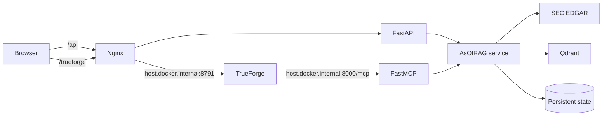

# AsOfRAG

AsOfRAG is a point-in-time RAG reliability agent for SEC filings. It discovers
live 10-K/10-Q filings, preserves filing-time provenance, builds isolated
Qdrant candidate collections, compares similarity-only retrieval with a hard
as-of filter, and promotes a candidate only through an explicit approval tool.

> Research software only. It does not provide investment advice.

## What the MVP includes

- FastAPI and Streamable HTTP FastMCP at `http://localhost:8000/mcp`
- live SEC EDGAR discovery/download with a required identifying user agent
- section-aware HTML parsing and deterministic content hashes
- FastEmbed vectors in persistent Qdrant storage
- separate candidate/production collections and a persisted promotion pointer
- Qdrant `filed_at_epoch <= as_of` filtering before vector ranking
- a React reliability dashboard with embedded `@truefoundry/trueforge-ui`
- nginx proxies for `/api/*` and the TrueForge base URL `/trueforge`

See [the architecture](docs/architecture.md) and
[the three-minute demo](docs/demo-script.md).

## Prerequisites

- Docker Desktop with Compose v2
- Node.js 24+ only if running the web app outside Docker
- Python 3.12+ only if running backend tests outside Docker
- TrueForge already running separately at `http://localhost:8791`

## Setup and run

1. Create the required local environment file:

   ```bash
   cp .env.example .env
   ```

   On PowerShell, use `Copy-Item .env.example .env`.

2. Edit `.env` and replace `SEC_USER_AGENT` with an application name and a
   monitored email address. SEC requests will not be enabled without it.

3. Build and start AsOfRAG:

   ```bash
   docker compose up --build -d
   docker compose ps
   ```

4. Verify:

   ```bash
   curl http://localhost:8000/health
   curl http://localhost:8000/api/status
   curl http://localhost:3000/health
   ```

5. Open `http://localhost:3000`.

Compose starts:

- web/nginx on `localhost:3000`;
- FastAPI/FastMCP on `localhost:8000`;
- Qdrant on `localhost:6333`.

Named volumes retain Qdrant data, FastEmbed downloads, SEC cache files, and the
JSON production/candidate state across container restarts.

## Configure TrueForge

TrueForge runs outside this Compose project. From the repository root:

```bash
TRUEFORGE_URL=http://localhost:8791 \
ASOFRAG_MCP_URL=http://host.docker.internal:8000/mcp \
ASOFRAG_REPOSITORY_URL=https://github.com/tejas-2232/asof-rag \
ASOFRAG_SKILL_REF=init-branch \
npx --yes tsx scripts/configure_trueforge.ts
```

PowerShell:

```powershell
$env:TRUEFORGE_URL = "http://localhost:8791"
$env:ASOFRAG_MCP_URL = "http://host.docker.internal:8000/mcp"
$env:ASOFRAG_REPOSITORY_URL = "https://github.com/tejas-2232/asof-rag"
$env:ASOFRAG_SKILL_REF = "init-branch"
npx --yes tsx scripts/configure_trueforge.ts
```

Override `TRUEFORGE_MODEL` if the default model is unavailable. The MCP URL is
intentionally `host.docker.internal`: TrueForge's container must reach the
host-published backend port.

## API and MCP contract

REST endpoints:

- `GET /health`
- `GET /api/status`
- `GET /api/filings?ticker=MSFT&forms=10-K`
- `POST /api/candidates/build`
- `POST /api/query`
- `POST /api/promote`

MCP tools:

- read-only: `list_filings`, `get_filing_source`, `query_production`,
  `compare_retrieval`
- write, non-destructive: `build_candidate`
- write, destructive/approval-gated: `promote_candidate`

Example hard as-of query payload:

```json
{
  "query": "What was Azure revenue growth?",
  "as_of": "2024-08-01T23:59:59Z",
  "ticker": "MSFT",
  "index": "candidate",
  "temporal_filter": true,
  "limit": 5
}
```

`compare_retrieval` reports safe and intentionally naive results for each
available production/candidate index. A candidate may contain filings from
multiple dates; safety comes from excluding future chunks in Qdrant before
similarity ranking.

## Local verification

```bash
python -m pip install -e "./services/mcp-server[test]"
python -m pytest
python -m compileall -q services/mcp-server/app
python -m ruff check services/mcp-server/app tests

cd apps/web
npm ci
npm run lint
npm run build
```

CI runs the same backend and frontend checks and validates/builds Compose.

## Architecture



## Demo

Follow [docs/demo-script.md](docs/demo-script.md). Build a candidate first,
run the same question and cutoff against naive production and safe candidate
retrieval, inspect accession/section citations, then approve promotion in
TrueForge. Do not claim a live SEC, model, Daytona, or TrueForge integration
unless it is visibly connected during the demo.

## AI assistant disclosure

This hackathon MVP was developed with AI coding assistants. The team reviewed
the resulting source, tests, security boundaries, documentation, and runtime
claims. Demo values shown while the backend is unavailable are explicitly
labeled as an illustrative preview and are not live measurements.

## Limitations

- The parser targets primary filing HTML and does not fully normalize every
  legacy SEC table/XBRL layout.
- Filing discovery currently uses the SEC submissions `recent` feed.
- Retrieval returns evidence chunks, not a generated financial answer.
- Promotion updates persisted application state; collections are retained for
  audit/rollback but there is no rollback endpoint in this MVP.
- Local MCP and REST endpoints have no authentication and must not be exposed
  publicly.
- The first FastEmbed build downloads model weights and can take several
  minutes.
- Daytona execution and TrueForge model credentials are external dependencies,
  not provided by this Compose project.

## Qodo Code Review Evidence

Merged PR URL: _pending_
