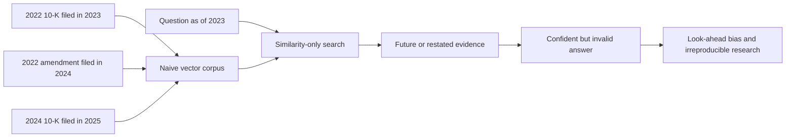
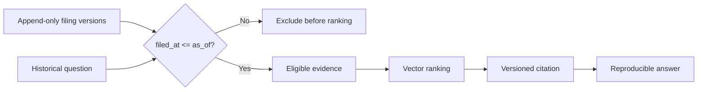
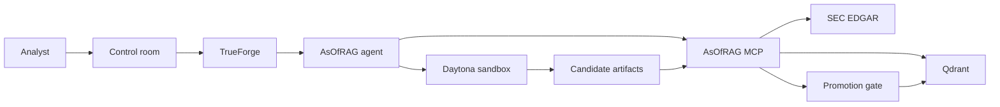
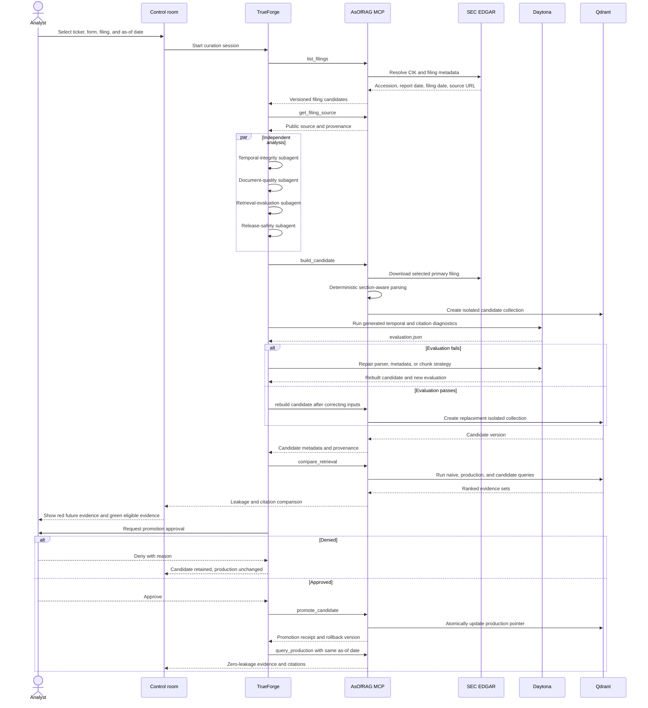

# Architecture

AsOfRAG is a release-safety workflow for financial RAG indexes. It prevents a
historical query from using information that was not public at the requested
time, then gives an agent a safe way to test and promote corrected indexes.

## Problem architecture

A normal financial RAG pipeline optimizes semantic similarity but does not
model when information became knowable. Original filings, later filings, and
amendments coexist in one vector space. A historically phrased question can
therefore receive a highly relevant passage published in the future.



AsOfRAG makes knowledge time a hard eligibility boundary and treats every index
change as a controlled release:



## Components



- **TrueForge** owns the agent loop, sessions, model credentials, tool routing,
  subagents, sandbox provisioning, and human approval.
- **Daytona** executes generated diagnostics and evaluation code. The MCP
  service owns the trusted, deterministic ingestion parser; SEC and model
  credentials remain outside the sandbox.
- **AsOfRAG MCP** exposes narrowly scoped financial-data and index-release
  tools through Streamable HTTP.
- **Qdrant** stores vectors and provenance for isolated candidate and
  production index versions.
- **Control room** provides a domain-specific view while embedding TrueForge's
  agent UI so the harness remains visible.

## Temporal contract

Every retrievable chunk carries:

- ticker and CIK;
- accession number and form;
- report date and filing date;
- SEC source URL and section;
- content hash and embedding model;
- index version.

`filed_at` is the knowledge timestamp. Safe retrieval applies this predicate
before vector ranking:

```text
filed_at <= as_of
```

Report date cannot substitute for filing date. An amended filing is appended
as another version rather than overwriting the original.

## Candidate lifecycle

1. Resolve a filing and preserve its source metadata.
2. Download and parse it through the trusted MCP ingestion path.
3. Stage chunks in a new candidate collection.
4. Compare naive, current production, and candidate retrieval with the same
   question and as-of date.
5. Reject candidates with future citations or missing provenance.
6. Require human approval for `promote_candidate`.
7. Switch the production pointer while retaining the prior collection for
   rollback and audit.

## Detailed agent workflow



### Workflow invariants

1. SEC source resolution happens through a real MCP tool.
2. Generated diagnostic/evaluation code runs only in Daytona; trusted
   ingestion code runs in the MCP service.
3. Temporal eligibility is applied before vector similarity.
4. Candidate data never mutates the active production collection.
5. Promotion is the only irreversible workflow step and requires approval.
6. The post-promotion query reuses the same question and as-of date, making the
   before/after result directly comparable.

## Trust boundaries

- TrueForge and the MCP service run locally for this submission.
- Daytona receives public filing content and generated code, never model or MCP
  credentials.
- The MCP server has no authentication in the local Compose network and must
  not be exposed to the public internet.
- SEC requests identify the application with `SEC_USER_AGENT`, throttle
  requests, and cache downloaded filings.
